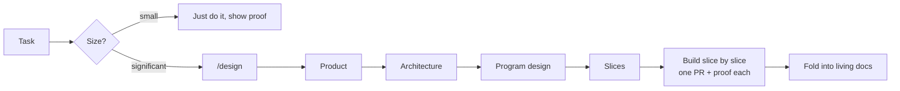

# agentic-setup

My Claude Code setup for building fast with agents while keeping the code good and
maintainable: a global `CLAUDE.md` and a `/design` skill.

Based on Dex Horthy's talk [Why Software Factories Fail](https://www.ai.engineer/talks/Ib5GBkD555M-harness-engineering-is-not-enough-why-software)
(agree on the design before code exists, keep reading the code) and ideas from
[pstack](https://flaviocopes.com/pstack) (encode engineering habits as skills), adapted to how I work.

## What's in it

```
CLAUDE.md                 global rules, loaded in every session
skills/design/
  SKILL.md                the /design process: size the work, run stages, stop for review
  product.md              stage: problem, users, behaviour, out of scope
  architecture.md         stage: components, contracts, data model, constraints
  program-design.md       stage: types, signatures, file layout, call flow
  slices.md               stage: build order, PRs, the check for each slice
  template.md             skeleton for docs/designs/YYYY-MM-DD-<slug>.md
```



Each stage in `/design` is drafted by the agent and approved by me before the next one starts.

## Install

```bash
./install.sh
```

This symlinks `CLAUDE.md` to `~/.claude/CLAUDE.md` and `skills/design` to
`~/.claude/skills/design`, so editing files here updates the setup straight away.
Anything already at those paths is moved aside with a `.bak` suffix first.

## Changing it

When I catch the same problem twice in review, I add a rule or check here. Keep `CLAUDE.md`
short; detailed processes go in skills, which only load when needed.
