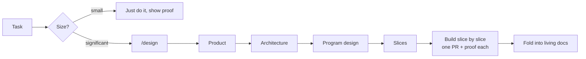

# agentic-setup

My coding-agent setup for building fast with agents while keeping the code good and
maintainable: global rules and a `design` skill. Works with Claude Code, Codex, Gemini CLI /
Antigravity, and anything else that reads `AGENTS.md` or Agent Skills.

Based on Dex Horthy's talk [Why Software Factories Fail](https://www.ai.engineer/talks/Ib5GBkD555M-harness-engineering-is-not-enough-why-software)
(agree on the design before code exists, keep reading the code) and ideas from
[pstack](https://flaviocopes.com/pstack) (encode engineering habits as skills), adapted to how I work.

## What's in it

```
CLAUDE.md                 global rules, loaded in every session
AGENTS.md                 symlink to CLAUDE.md, for agents that read AGENTS.md
skills/design/
  SKILL.md                the /design process: size the work, run stages, stop for review
  product.md              stage: problem, users, behaviour, out of scope
  architecture.md         stage: components, contracts, data model, constraints
  program-design.md       stage: types, signatures, file layout, call flow
  slices.md               stage: build order, PRs, the check for each slice
  template.md             skeleton for docs/designs/YYYY-MM-DD-<slug>.md
```



Each stage in `/design` is drafted by the agent and approved by me before the next one starts.

## Install

```bash
./install.sh
```

This symlinks the rules and every skill in `skills/` into each agent's global config, so
editing files here updates every agent straight away:

| Agent | Rules | Skills |
|---|---|---|
| Claude Code | `~/.claude/CLAUDE.md` | `~/.claude/skills/` |
| Codex | `~/.codex/AGENTS.md` | `~/.codex/skills/` |
| Gemini CLI / Antigravity | `~/.gemini/GEMINI.md` | `~/.gemini/skills/` |

Claude Code is always set up; the others only if their config folder already exists.
Anything already at those paths is moved aside with a `.bak` suffix first. Re-running is safe.

Cursor has no global rules file: paste `CLAUDE.md` into Settings → Rules → User Rules, or
symlink `AGENTS.md` into a project's root.

Using it in your own setup: fork it, then rewrite `CLAUDE.md` for how *you* work. The rules
here came from reviewing my own sessions, so they won't all fit you.

## Changing it

When I catch the same problem twice in review, I add a rule or check here. Keep `CLAUDE.md`
short; detailed processes go in skills, which only load when needed.
