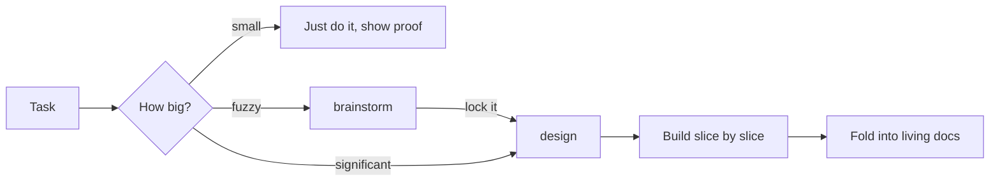

# agentic-setup

My coding-agent setup for building fast with agents while keeping the code good and
maintainable: global rules plus a `brainstorm` and a `design` skill. Works with Claude Code,
Codex, Gemini CLI / Antigravity, and anything else that reads `AGENTS.md` or Agent Skills.

## Why this exists

Agents write code fast, but speed alone doesn't make good software. Dex Horthy's talk
[Why Software Factories Fail](https://www.ai.engineer/talks/Ib5GBkD555M-harness-engineering-is-not-enough-why-software)
puts the problem well:

- Models are trained to make tests pass. Nothing in training penalises code that is hard to
  change later, so agents take shortcuts that still pass: swallowed errors, type casts,
  edited tests.
- The cost of a bad design shows up months later, long after the change that caused it.
- Once writing code is fast, review becomes the slow part. Skipping review doesn't remove that
  cost; you pay it later, debugging code nobody read.

His answer, and the idea behind this repo: **keep reading the code, and make that cheap by
agreeing on decisions before any code exists.** A change that matches an approved design is
quick to review. A change that doesn't means redesigning in the PR.

[pstack](https://flaviocopes.com/pstack) adds the other half: write good engineering habits
down as instructions the agent follows, the way you'd onboard a new engineer.

The rules themselves came from reviewing my own agent sessions and commits: what I kept
correcting, and which bugs reached me instead of being caught.

## How it fits together



The amount of process grows with the risk. A one-line fix stays fast; a new system gets
designed and approved stage by stage.

## What's in it

```
CLAUDE.md                     global rules, loaded in every session
AGENTS.md                     symlink to CLAUDE.md, for agents that read AGENTS.md
install.sh                    links the rules and skills into each agent's config
skills/brainstorm/
  SKILL.md                    the loop: frame, spread out, push back, test, log
  arena.md                    "go wide": competing agents plus a judge
  log-template.md             running log of ideas, rejects and tests
  brief-template.md           one-page decision brief that design starts from
skills/design/
  SKILL.md                    size the work, run the stages, review, build, stop for approval
  product.md                  stage: problem, users, behaviour, out of scope
  architecture.md             stage: terms, components, contracts, data, jobs, invariants, failures
  program-design.md           stage: types, signatures, file layout, call flow
  slices.md                   stage: build order, PRs, the check for each slice
  template.md                 skeleton for docs/designs/YYYY-MM-DD-<slug>.md
  scripts/build_artifact.py   builds one artifact page from a design markdown file
  scripts/preview.py          serves built pages for the local browser preview
```

## Why each part is the way it is

### CLAUDE.md: always-on rules

It's loaded into every session, so it holds only what applies every time and stays short. A
long rules file dilutes the rules that matter. Anything that only applies sometimes is a skill.

| Section | Why |
|---|---|
| Sizing the work | Small changes stay fast. Only significant work goes through the design process. |
| When I'm vague | My wording is loose, so the agent picks the likelier reading and says so instead of stalling. Opinions come as researched, numbered options with sources, so I can answer "do 2". |
| Taste | Simple by default, and nothing that reads as AI-generated. |
| Code | Targets the shortcuts models are trained into: swallowed errors, casts to silence types, editing tests to pass. Tunable numbers live in one place so they can be measured and changed. |
| Proving it works | In my own sessions, broken mobile layouts and logic bugs reached me before the agent noticed. So every change is checked the way it's used, numeric targets are measured, and the agent shows the proof (screenshots, numbers, output) instead of claiming it. |
| Explaining | Diagrams beat walls of text. In chat they go in an artifact, because a Mermaid code block in chat doesn't render. |
| Docs | See below. |
| Git and pull requests | One slice per commit or PR, because small changes are cheap to review. PR descriptions are written for someone who hasn't seen the chat. Nothing public or destructive happens without asking. |

**Docs** split into two kinds:

- **Living docs** (product, architecture, glossary, topics, guides) describe the system as it
  is now and change with the code. They're what an agent reads first, so they must not go stale.
- **Records** (design files, decision notes) are dated and never rewritten. They explain *why*
  things are the way they are.

Docs are written for a person reading top to bottom: plain words, a glossary for hard terms,
and code pointers only in a short "Where in the code" section at the end. Agents tend to
scatter file paths and line numbers through docs to help themselves find code, which makes
them hard to read; agents can search the code anyway.

`/docs` is served in dev only, because internal docs can give away things visitors shouldn't
see, such as how odds work or what an API trusts.

### brainstorm: for when the idea isn't settled

Design is a straight line; brainstorming is a loop. Mixing them either rushes the thinking or
stalls the design, so they're separate skills.

- **Push back every round.** Agents tend to agree with whatever you lean towards. The skill
  makes it name the weakest assumption and argue for the best option you're not choosing.
- **Test instead of debating.** A quick prototype or benchmark settles questions faster than
  argument. Tests live in `/tmp`, never in the repo, and only the result is kept. Long tests
  get their own session, since a background subagent dies with the session that started it.
- **One running log.** Long chats outlast the agent's memory of them, and rejected ideas creep
  back. The log is the one place that remembers, and it's the only thing updated every round.
- **Arena ("go wide").** Several agents each argue a different approach without seeing the
  others, so they don't all anchor on the first idea. A separate judge compares them.
- **Lock it.** Ends with a one-page brief, so the design skill starts from what was settled
  instead of asking again.

### design: agree before building

The four stages come from the talk: **product → architecture → program design → vertical
slices**, each drafted by the agent and approved by me before the next starts.

- **Clarify first.** The agent says what the stage has to decide and what it's assuming before
  drafting, so drafts aren't built on a wrong guess.
- **Product in plain words; architecture in the project's own names.** Product is for anyone.
  Architecture is real system design (contracts, data, jobs, invariants, failures) and keeps
  real names so it maps to the code, with a Terms list explaining them.
- **Program design opens with pictures** (reused / new / deleted, and the main flow step by
  step) before signatures, so the shape is clear before the details.
- **Vertical slices.** Each slice works end to end and has an agreed check. Models tend to plan
  horizontally ("all the types, then all the API"), which leaves nothing working until the end.
- **Review before approval.** Five questions catch the design bugs that are easiest to miss:
  a rule decided in two places, two workers grabbing the same thing, numbers that are guesses,
  a first release that's too big, and dependencies on other people.
- **The markdown is the only source.** An earlier version had the agent write a separate page
  for reviewers, and the two drifted apart. Now the page is built from the markdown by
  `build_artifact.py` and never edited by hand. `preview.py` shows the same page locally, since
  `file://` can't open large pages.
- **A fresh session per stage on long designs.** Long chats get worse as they grow; the design
  file carries everything the next stage needs.
- **Fold back when done.** What was learned goes into the living docs and decision notes, so
  the design file can stay a frozen record.

### install.sh and AGENTS.md: one source for every agent

`CLAUDE.md` is the only rules file; `AGENTS.md` is a symlink to it for agents that look for
that name. `install.sh` symlinks rather than copies, so editing a file here changes every
agent's setup at once, with nothing to keep in sync.

## Install

```bash
./install.sh
```

This symlinks the rules and every skill in `skills/` into each agent's global config:

| Agent | Rules | Skills |
|---|---|---|
| Claude Code | `~/.claude/CLAUDE.md` | `~/.claude/skills/` |
| Codex | `~/.codex/AGENTS.md` | `~/.codex/skills/` |
| Gemini CLI / Antigravity | `~/.gemini/GEMINI.md` | `~/.gemini/skills/` |

Claude Code is always set up; the others only if their config folder already exists.
Anything already at those paths is moved aside with a `.bak` suffix first. Re-running is safe.

The design scripts need Python 3 and the `markdown` package (`python3 -m pip install markdown`).

Cursor has no global rules file: paste `CLAUDE.md` into Settings → Rules → User Rules, or
symlink `AGENTS.md` into a project's root.

Using it in your own setup: fork it, then rewrite `CLAUDE.md` for how *you* work. The rules
here came from reviewing my own sessions, so they won't all fit you.

## Changing it

When I catch the same problem twice in review, I add a rule or check here. Keep `CLAUDE.md`
short; detailed processes go in skills, which only load when needed.

## Terms

- **Artifact**: a web page Claude publishes and links to from the chat.
- **Living doc**: a doc that always describes the system as it is now.
- **Record**: a dated doc (a design or a decision) that is never rewritten.
- **Vertical slice**: a small piece of work that runs end to end through every layer it needs.
- **Arena**: several agents developing competing approaches independently, then a judge.
